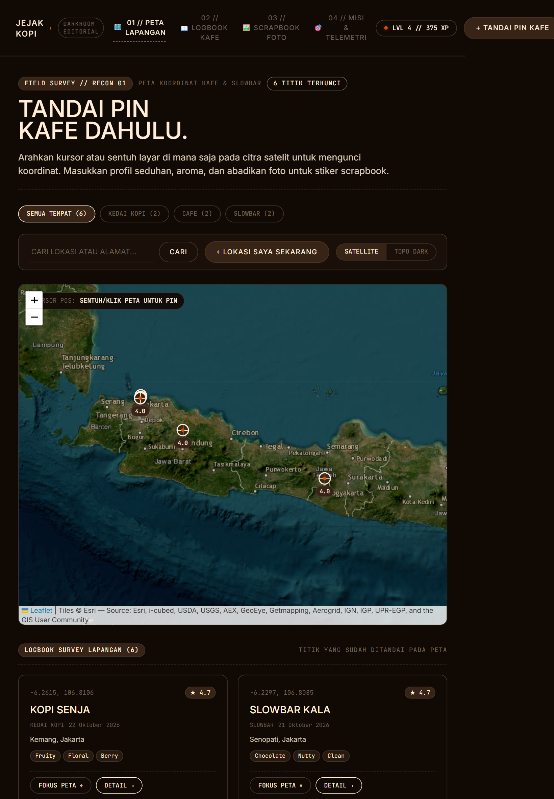

# ☕ Jejak Kopi (Coffee Journey 2.0)
> **Darkroom Product Editorial & Coffee Expedition Journal** — Aplikasi web interaktif cafe hunting & jurnal kopi berbasis **Tailwind CSS** dengan estetika **ORYZO AI Darkroom Editorial**: kanvas gelap hangat (*Walnut Shadow* `#100904`), tipografi krem (*Warm Cream* `#ffedd7`), aksen solid *Bark Brown* (`#382416`), garis pemisah *Cork Border* (`#40372e`), dan aksen *Ember* (`#dc5000`). Dilengkapi **Interactive Drag & Drop Scrapbook Book**, **AI Photo Scanner & Die-Cut Sticker Generator**, **Pin-First Satellite Map**, dan gamifikasi misi petualangan rasa.


---

## ⚡ Filosofi Desain: ORYZO AI Darkroom Editorial

Desain antarmuka dirancang mengikuti sistem desain **ORYZO AI**:
- **Palet Warna Warm Darkroom**:
  - `Walnut Shadow (#100904)`: Kanvas gelap hangat natural (bukan hitam pekat LCD sintetis).
  - `Warm Cream (#ffedd7)`: Teks utama dan garis interaktif yang hangat seperti kertas klasik.
  - `Bark Brown (#382416)`: Permukaan solid untuk satu-satunya tombol CTA utama (*single solid CTA*).
  - `Cork Border (#40372e)`: Hairline dashed dividers (1px garis putus-putus) dan pembatas kontainer.
  - `Driftwood (#6c5f51)`: Nuansa abu-abu hangat transisi untuk teks sekunder.
  - `Ember Accent (#dc5000)`: Aksen oranye untuk link, tag khusus, dan indikator status aktif.
- **Tipografi Editorial**:
  - **Uppercase Weight 500**: Standar tegas pada navigasi, heading, tombol, dan label data.
  - **Mixed Case Weight 400**: Khusus untuk catatan seduhan, deskripsi cupping, dan cerita jurnal lapangan.
  - **Line-Height Ketat (0.9)**: Menghasilkan judul display yang sculptural seperti karya editorial majalah desain.
- **Kemudahan Pemeliharaan (Maintainability)**:
  - Dibangun dengan **Tailwind CSS** + **PostCSS** + konfigurasi token terpusat di `tailwind.config.js`.
  - Komponen modular dan kelas utilitas yang terstruktur rapi.
- **Zero Drop-Shadows**: Kedalaman visual murni dicapai dari hierarki warna permukaan (`#100904` → `#382416`), tanpa efek blur berlebihan.

---

## 🗺️ Fitur Utama

### 1. ⌖ Peta Lapangan Satelit (Pin-First Workflow — Fitur Utama)
Halaman awal langsung menyajikan terminal peta satelit resolusi tinggi sehingga kamu dapat langsung menandai titik sebelum mengisi jurnal:
- **Tandai Langsung di Peta**: Klik/sentuh koordinat mana pun pada peta satelit untuk memunculkan bidik reticle warm cream/ember dan membuka laci aksi cepat (*floating quick action drawer*).
- **HUD Telemetri Koordinat Realtime**: Menampilkan `CURSOR POS` (latitude/longitude saat kursor bergerak) dan `TARGET PIN` secara presisi.
- **Filter Cepat Kategori**: Filter instan berdasarkan *Slowbar, Kedai Kopi, Cafe, atau Semua Tempat*.
- **Lokasi Saya Instan (GPS)**: Tombol `⌖ LOKASI SAYA SEKARANG` untuk langsung mengunci koordinat GPS perangkat kamu di lapangan.
- **Pencarian Alamat & Tempat**: Kolom pencarian minimalis (*underline-only*) terintegrasi dengan OpenStreetMap Nominatim.
- **Reverse Geocoding Otomatis**: Mendeteksi nama jalan, kelurahan, dan kota secara otomatis saat koordinat dipilih.

| Peta Satelit & Penandaan Pin Baru | Formulir Logbook dengan Quick Scan & Mini Map |
| :---: | :---: |
|  |  |

---

### 2. 🖼️ Interactive Drag & Drop Scrapbook Book & Stiker Koleksi
- **Buku Jurnal Interaktif Bebas Tata Letak**: Letakkan dan susun foto polaroid, stiker notes rasa, selotip washi tape, dan lencana stempel sesuka hati dengan gestur *drag and drop* (mendukung mouse & *touchscreen* di tablet dan ponsel).
- **Kontrol Fleksibel**: Putar sudut kemiringan (`↺`, `↻`), ubah ukuran (`−`, `+`), atur urutan lapisan (`⬆`), dan hapus (`✕`) setiap elemen secara presisi.
- **Tulis Cerita & Catatan Tangan di Buku**: Tambahkan memo catatan tulisan tangan (*handwritten note*) langsung di lembaran buku untuk mengabadikan momen, cerita barista, maupun suasana hari itu dengan font tulisan tangan autentik (*Caveat*).
- **Sekoci Aksesoris**: Koleksi selotip washi tape (*Kraft, Amber, Matcha, Espresso*) dan stempel kurasi kopi (*Fresh Brew, Single Origin, Slowbar Archive, Approved Taste*).
- **Pilihan Kertas Buku**: *Walnut Darkroom, Kertas Kraft, Krem Vellum, dan Kotak-kotak (Grid)*.
- **Ekspor PNG Resolusi Tinggi**: Unduh seluruh halaman buku yang telah kamu rancang sebagai gambar PNG tajam berkualitas tinggi untuk dibagikan ke Instagram Stories atau dicetak.

<p align="center">
  
</p>

---

### 3. 📷 AI Photo Scanner & Die-Cut Sticker / Cupping Card Generator
- **Pemindai Kartu Rasa & Cangkir Kopi**: Unggah atau foto kartu notes rasa (*cupping card*) atau cangkir kopi yang diberikan oleh barista.
- **Mesin OCR Klien (Tesseract.js)**: Membaca teks pada kartu rasa secara lokal di browser dan otomatis mendeteksi profil rasa (*Peach, Jasmine, Citrus, Floral, Chocolate, dll.*), origin biji kopi, serta metode seduh untuk mengisi formulir jurnal secara otomatis.
- **Generator Stiker Die-Cut**: Otomatis memotong gambar dengan tepi kontur putih (*white die-cut border*) dan kilau stiker vinil glossy.
- **Kartu Cupping Koleksi Vintage**: Mengubah data hasil scan menjadi kartu koleksi bernomor seri autentik dengan cap segel emas yang bisa langsung ditempelkan ke buku scrapbook.

---

### 4. 🎮 Misi & Telemetri Gamifikasi (Expedition Operator)
- **Tingkat & Peringkat Operator**: Dari *Pemburu Pemula*, *Penjelajah Kafe*, *Kartografer Seduh*, hingga *Legenda Coffee Sommelier*.
- **Sistem Perolehan XP**:
  - Kafe baru: `+25 XP`
  - Kunjungan ulang: `+10 XP`
  - Jenis tempat baru: `+15 XP`
  - Buat stiker dari scan foto: `+30 XP`
  - Susun lembaran scrapbook buku: `+25 XP`
  - Foto dokumentasi: `+5 XP` per foto
  - Pin koordinat di peta: `+5 XP`
  - Profil rasa kopi diisi: `+5 XP`
  - Catatan deskriptif (≥ 20 huruf): `+10 XP`
- **8 Misi Mingguan Dinamis**: Misi eksplorasi yang diperbarui berkala termasuk misi memindai kartu rasa dan menaruh pin.
- **16 Lencana Penghargaan Lapangan**: *Tegukan Pertama, Rutin Ngopi, Cafe Hopper, Kartografer Peta, Slowbar Lover, Sticker Artisan, Coffee Storyteller, Sommelier Rasa, dll.*
- **Efek Konfeti Selebrasi**: Umpan balik visual saat menyelesaikan misi dan mencapai level baru.


---

### 5. 📱 Sepenuhnya Responsif: Ponsel, Tablet, dan Desktop

Dirancang khusus agar nyaman digunakan langsung di kedai kopi menggunakan ponsel pintar (*one-handed mobile bottom nav*) maupun tablet (*touch stylus canvas*):

| Tampilan Tablet (iPad Air / Tab) | Tampilan Ponsel (Mobile Bottom Nav) |
| :---: | :---: |
|  |  |

---

### 6. 💾 Penyimpanan Offline-First & Keamanan Data
- Berjalan sepenuhnya di sisi klien menggunakan **IndexedDB** berkapasitas besar.
- Kompresi foto otomatis di peramban sehingga hemat ruang penyimpanan dan cepat dimuat.
- **Ekspor Cadangan JSON** dan **Impor** untuk memindahkan data antar perangkat dengan aman tanpa server pihak ketiga.

---

## 🛠️ Tumpukan Teknologi (Tech Stack)

- **Frontend Core**: [React 18](https://react.dev/) + [Vite 5](https://vitejs.dev/)
- **Styling Framework**: [Tailwind CSS v3](https://tailwindcss.com/) + [PostCSS](https://postcss.org/) + [Autoprefixer](https://github.com/postcss/autoprefixer)
- **Computer Vision & OCR**: [Tesseract.js](https://tesseract.projectnaptha.com/) + HTML5 Canvas Image Processor
- **Peta Satelit**: [Leaflet](https://leafletjs.com/) + [React-Leaflet](https://react-leaflet.js.org/) + [Esri World Imagery](https://www.arcgis.com/home/item.html?id=10df2279f9684e4a9f6a7f08febac2a9) + OSM Nominatim
- **Sistem Desain**: ORYZO AI Style Reference (`#100904` Walnut Shadow, `#ffedd7` Warm Cream, `#382416` Bark Brown, `#40372e` Cork Border, `#dc5000` Ember Accent)
- **Tipografi**: Inter, JetBrains Mono, Caveat (Handwriting), Fraunces (Vintage Serif)
- **Database**: IndexedDB Browser API

---

## 🚀 Cara Menjalankan di Lokal

Pastikan [Node.js](https://nodejs.org/) (versi 18+) sudah terpasang di komputermu:

```bash
# 1. Clone repositori ini
git clone https://github.com/soulblade12/coffee-journey-1.0.git
cd coffee-journey-1.0

# 2. Pasang dependensi
npm install

# 3. Jalankan server pengembangan
npm run dev
```

Buka peramban di `http://localhost:5173`.

### Build untuk Produksi
```bash
npm run build
```
Hasil siap saji akan otomatis dibangun di dalam folder `dist/`.

---

Dibuat dengan ☕ untuk para penikmat kopi & cafe hunters.
