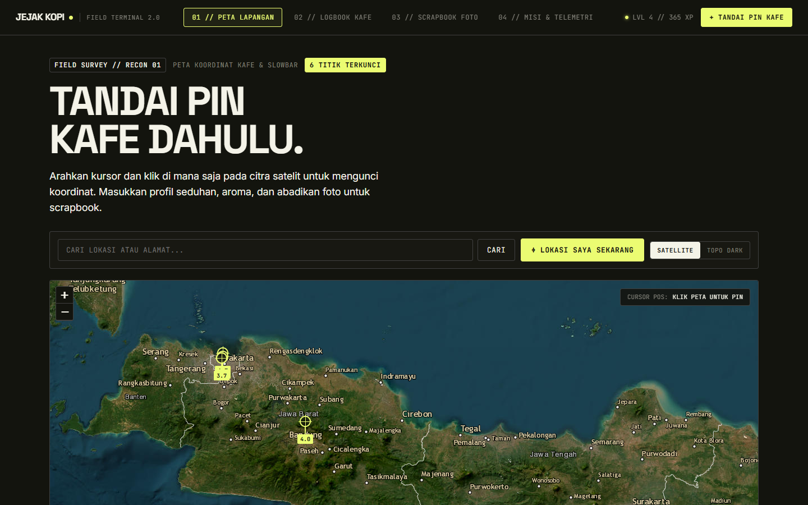
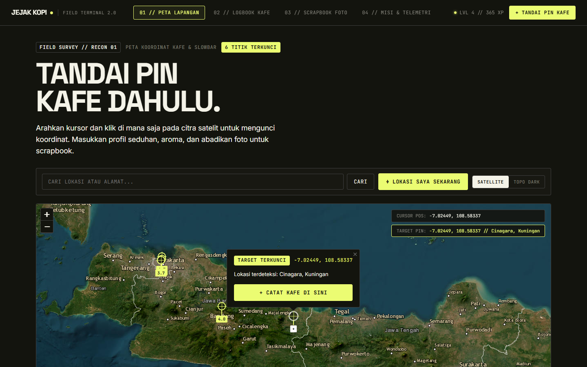
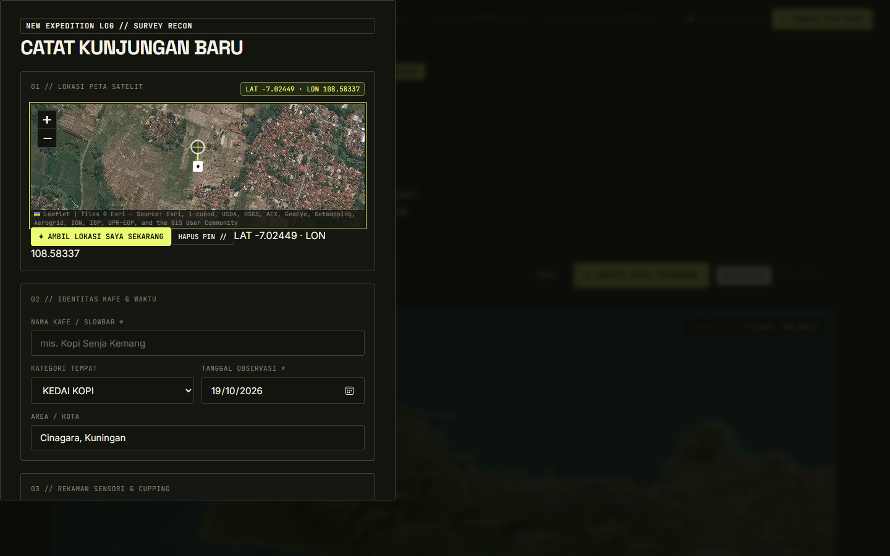
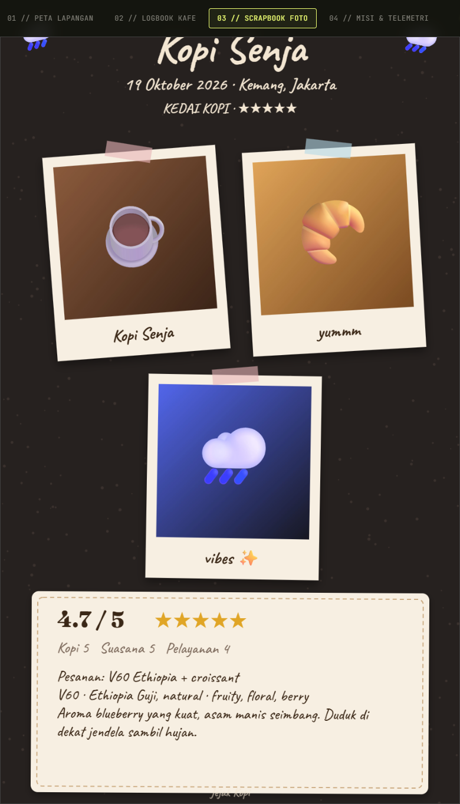
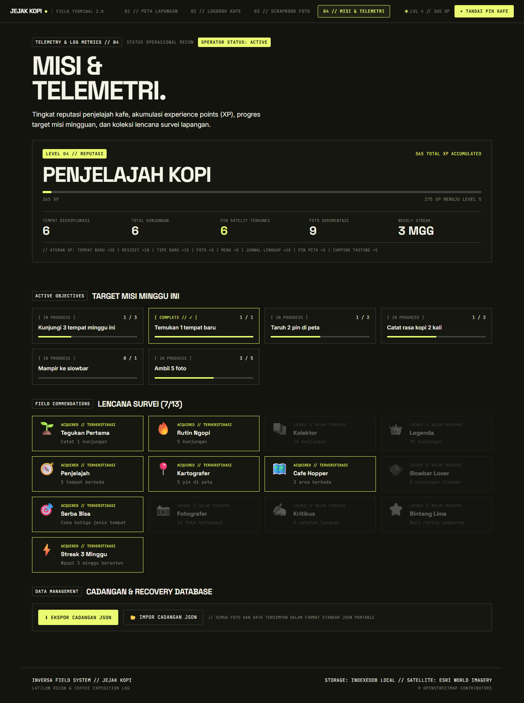
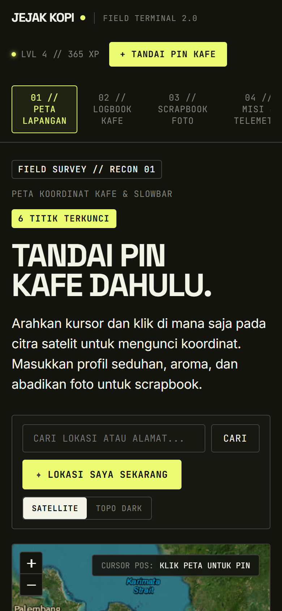

# ☕ Jejak Kopi (Coffee Journey 1.0)
> **Topographic Field Terminal & Coffee Journal at Midnight** — Aplikasi web interaktif cafe hunting & jurnal kopi bergaya terminal satelit lapangan, berfokus utama pada penandaan pin koordinat di peta satelit terlebih dahulu (*Pin-First Workflow*), telemetri degustasi rasa kopi, gamifikasi misi ekspedisi, dan generator scrapbook polaroid.



---

## ⚡ Filosofi Desain: INVERSA Terminal Lapangan

Desain antarmuka dirancang ulang sepenuhnya mengikuti bahasa desain **INVERSA**:
- **Palet Warna Taktis**: Obsidian Loam (`#13140e`) sebagai kanvas gelap natural, Bone Vellum (`#f4f3e8`) untuk tipografi editorial yang hangat seperti kertas vellum, dan aksen **Lime Surveyor (`#ebfc72`)** untuk target reticle & penanda aktif.
- **Tipografi Berkarakter**: Kombinasi **Space Grotesk** untuk display editorial berskala besar dan **JetBrains Mono** untuk seluruh koordinat, label data, status telemetri, dan stempel waktu.
- **Geometri Presisi**: Sudut tajam 3.6px (*flat, unadorned, zero-elevation*) menghadirkan nuansa instrumen penjelajah lapangan.
- **Citra Satelit Beresolusi Tinggi**: Peta berbasis **Esri World Imagery** dengan foto satelit bumi nyata yang kontras dengan reticle bidik neon-lime.

---

## 🗺️ Fitur Utama

### 1. ⌖ Peta Lapangan Satelit (Pin-First Workflow — Fitur Utama)
Halaman awal langsung menyajikan terminal peta satelit resolusi tinggi sehingga kamu dapat langsung menandai titik sebelum mengisi jurnal:
- **Tandai Langsung di Peta**: Klik koordinat mana pun pada peta satelit untuk memunculkan bidik reticle lime dan membuka dialog *Tandai Kafe di Titik Ini*.
- **HUD Telemetri Koordinat Realtime**: Menampilkan `CURSOR POS` (latitude/longitude saat kursor bergerak) dan `TARGET PIN` secara presisi.
- **Lokasi Saya Instan (GPS)**: Tombol `⌖ LOKASI SAYA SEKARANG` untuk langsung mengunci koordinat GPS perangkat kamu di lapangan.
- **Pencarian Alamat & Tempat**: Kolom pencarian terintegrasi dengan OpenStreetMap Nominatim.
- **Reverse Geocoding Otomatis**: Mendeteksi nama jalan, kelurahan, dan kota secara otomatis saat koordinat dipilih.
- **Tabel Log Ekspedisi**: Ringkasan daftar kafe yang telah ditandai lengkap dengan stempel koordinat dan link cepat ke detail.

| Peta Satelit & Penandaan Pin Baru | Formulir Logbook dengan Mini Map Satelit |
| :---: | :---: |
|  |  |

---

### 2. 📖 Logbook Kafe & Degustasi Rasa
- Catat kedai kopi, roastery, slowbar, maupun espresso bar favoritmu.
- **Rating 3 Dimensi**: Kopi, Suasana, dan Pelayanan beserta kalkulasi skor agregat.
- **Degustasi Cupping Lengkap**:
  - Metode seduh (*Espresso, V60, Aeropress, Japanese Iced, Cold Brew, Kalita Wave, dll.*)
  - Origin / jenis biji kopi (*Single Origin, Blend, Process*)
  - 15 pilihan chips profil rasa (*Fruity, Floral, Citrus, Caramel, Nutty, Creamy, Clean, Fermented, dll.*)
- Pencarian instan berdasarkan nama kafe, area, origin biji kopi, maupun filter rasa.


---

### 3. 🖼️ Scrapbook Polaroid Generator
- Ubah dokumentasi foto kunjungan menjadi lembaran scrapbook estetis.
- Tampilan foto bergaya polaroid miring dengan selotip washi tape, stiker ekspedisi, dan catatan tiket seduhan.
- Pilihan tekstur kertas: *Obsidian Night, Kertas Kraft, Krem Vellum, dan Kotak-kotak (Grid)*.
- Tombol **🎲 Acak Tata Letak** untuk mengocok sudut kemiringan dan posisi secara dinamis.
- Ekspor langsung dalam resolusi tinggi sebagai format **PNG**.

<p align="center">
  
</p>

---

### 4. 🎮 Misi & Telemetri Gamifikasi (Expedition Operator)
- **Tingkat & Peringkat Operator**: Dari *Operator Pemula* hingga *Master Roastery & Explorer*.
- **Sistem Perolehan XP**:
  - Kafe baru: `+25 XP`
  - Kunjungan ulang: `+10 XP`
  - Jenis tempat baru: `+15 XP`
  - Foto dokumentasi: `+5 XP` per foto
  - Pin koordinat di peta: `+5 XP`
  - Profil rasa kopi diisi: `+5 XP`
  - Catatan deskriptif (≥ 20 huruf): `+10 XP`
- **Misi Mingguan Dinamis**: Misi eksplorasi yang diperbarui berkala untuk memicu petualangan baru.
- **13 Lencana Penghargaan Lapangan**: *Tegukan Pertama, Rutin Ngopi, Cafe Hopper, Kartografer, Slowbar Lover, Fotografer, Bintang Lima, dll.*
- **Efek Konfeti Selebrasi**: Umpan balik visual saat menyelesaikan misi dan mencapai level baru.



---

### 5. 💾 Penyimpanan Offline-First & Keamanan Data
- Berjalan sepenuhnya di sisi klien menggunakan **IndexedDB** berkapasitas besar.
- Kompresi foto otomatis di peramban sehingga hemat ruang penyimpanan dan cepat dimuat.
- **Ekspor Cadangan JSON** dan **Impor** untuk memindahkan data antar perangkat dengan aman tanpa server pihak ketiga.

---

## 🛠️ Tumpukan Teknologi (Tech Stack)

- **Frontend Core**: [React 18](https://react.dev/) + [Vite 5](https://vitejs.dev/)
- **Peta Satelit**: [Leaflet](https://leafletjs.com/) + [React-Leaflet](https://react-leaflet.js.org/) + [Esri World Imagery](https://www.arcgis.com/home/item.html?id=10df2279f9684e4a9f6a7f08febac2a9) + OSM Nominatim
- **Sistem Desain**: INVERSA Style Specification (Obsidian Loam `#13140e`, Bone Vellum `#f4f3e8`, Lime Surveyor `#ebfc72`, Iron Filings `#404040`)
- **Tipografi**: JetBrains Mono, Space Grotesk, Inter, Caveat, Fraunces (via Google Fonts)
- **Rendering Kanvas**: HTML5 Canvas API (Generator Scrapbook PNG)
- **Database**: IndexedDB Browser API

---

## 🚀 Cara Menjalankan di Lokal

Pastikan [Node.js](https://nodejs.org/) (versi 18+) sudah terpasang di komputermu:

```bash
# 1. Clone repositori ini
git clone https://github.com/soulblade12/coffee-journey-1.0.git
cd coffee-journey-1.0

# 2. Pasang dependensi
npm install

# 3. Jalankan server pengembangan
npm run dev
```

Buka peramban di `http://localhost:5173`.

### Build untuk Produksi
```bash
npm run build
```
Hasil siap pakai akan otomatis dibangun di dalam folder `dist/`.

---

## 📱 Tampilan Mobile

Dirancang responsif untuk memudahkan inspeksi dan pencatatan langsung saat berada di kedai kopi:

<p align="center">
  
</p>

---

Dibuat dengan ☕ untuk para penikmat kopi & cafe hunters.
