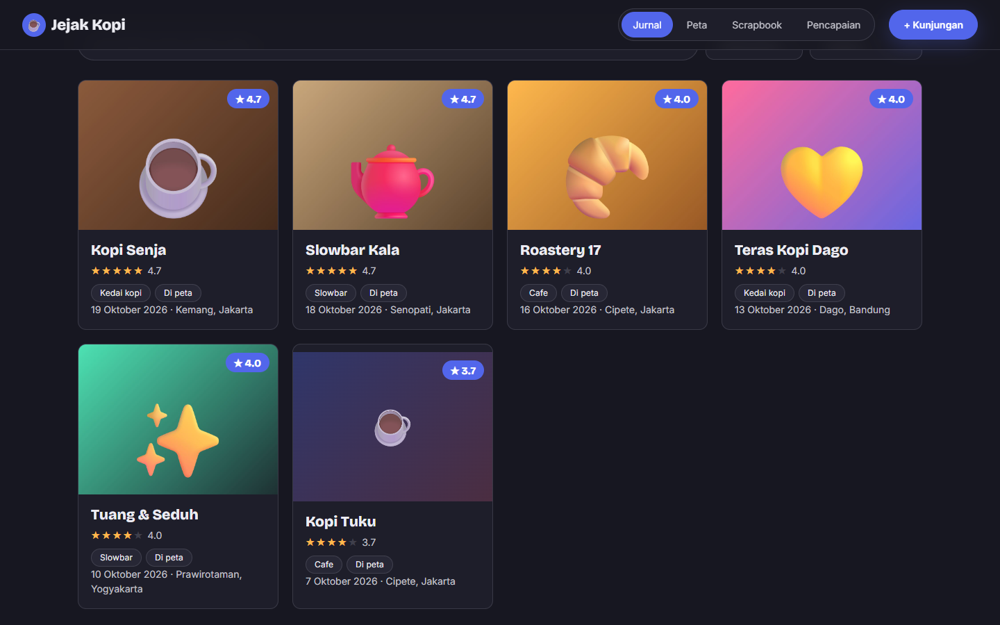

# ☕ Jejak Kopi (Coffee Journey)

> **Aplikasi web interaktif untuk cafe hunting, mencatat jurnal rasa kopi, menandai pin di peta lokasi, sistem gamifikasi seru (XP, level, misi mingguan, lencana), dan membuat foto scrapbook polaroid otomatis.**


---

## ✨ Fitur Utama

### 1. 📖 Jurnal Kafe & Slowbar
- Catat kedai kopi, cafe, maupun slowbar favoritmu.
- Rating mendalam 3 dimensi: **Kopi**, **Suasana**, dan **Pelayanan** beserta skor keseluruhan.
- Catatan degustasi kopi:
  - Metode seduh (*Espresso, V60, Aeropress, Japanese Iced, Cold Brew, dll.*)
  - Origin / jenis biji kopi
  - 15 pilihan chips rasa (*Fruity, Floral, Citrus, Caramel, Nutty, Creamy, Clean, dll.*)
- Pencarian cerdas instan berdasarkan nama, area, pesanan, biji kopi, maupun profil rasa.



---

### 2. 🗺️ Peta Interaktif & Pin Lokasi
- **Tandai Sendiri di Peta**: Cukup klik titik mana pun di peta untuk menaruh pin dan mencatat kopi di lokasi tersebut.
- **Lokasi Saya (Geolokasi GPS)**: Deteksi otomatis lokasi kamu saat ini dengan satu klik.
- **Pencarian Alamat**: Cari nama tempat atau daerah di peta menggunakan OpenStreetMap Nominatim.
- **Reverse Geocoding**: Otomatis mendeteksi nama area & daerah saat pin ditaruh.
- **Peta Mini di Form**: Geser pin secara manual atau gunakan lokasi saat ini langsung dari formulir input.

| Peta Interaktif & Pin Baru | Formulir dengan Peta & Profil Rasa |
| :---: | :---: |
|  |  |

---

### 3. 🖼️ Scrapbook Generator Otomatis
- Ubah foto-foto kunjunganmu menjadi lembaran scrapbook estetis.
- Tampilan foto bergaya polaroid miring dengan selotip washi tape berwarna, stiker, dan catatan tiket seduhan.
- Pilihan kertas vintage: *Malam (Dark), Kertas Kraft, Krem Polos, dan Kotak-kotak (Grid)*.
- Tombol **🎲 Acak Tata Letak** untuk mengocok susunan scrapbook secara dinamis.
- Unduh langsung sebagai berkas **PNG resolusi tinggi**.

<p align="center">
  
</p>

---

### 4. 🎮 Gamifikasi & Misi Mingguan (Cafe Hunting)
- **Tingkat & Peringkat Pemburu**: Naik dari *Pemburu Pemula* hingga *Legenda Cafe Hunter*.
- **Sistem XP**:
  - Tempat baru: `+25 XP`
  - Kunjungan ulang: `+10 XP`
  - Jenis tempat baru: `+15 XP`
  - Foto diunggah: `+5 XP` per foto
  - Pin di peta: `+5 XP`
  - Profil rasa kopi diisi: `+5 XP`
  - Catatan lengkap (≥ 20 huruf): `+10 XP`
- **Misi Mingguan**: Reset otomatis setiap minggu untuk memotivasi eksplorasi kafe baru.
- **13 Lencana Pencapaian**: *Tegukan Pertama, Rutin Ngopi, Cafe Hopper, Kartografer, Slowbar Lover, Fotografer, Bintang Lima, dll.*
- **Efek Konfeti**: Selebrasi visual saat menyimpan kunjungan, naik level, atau menyelesaikan misi.


---

### 5. 💾 Penyimpanan Lokal & Cadangan
- Semua data tersimpan aman di **IndexedDB** browser (kapasitas besar untuk foto).
- Kompresi foto otomatis di sisi klien agar hemat ruang penyimpanan.
- Fitur **Ekspor Cadangan JSON** dan **Impor** untuk memindahkan data antar perangkat.

---

## 🛠️ Teknologi yang Digunakan

- **Frontend**: [React 18](https://react.dev/) + [Vite 5](https://vitejs.dev/)
- **Peta Interaktif**: [Leaflet](https://leafletjs.com/) + [React-Leaflet](https://react-leaflet.js.org/) + [OpenStreetMap](https://www.openstreetmap.org/)
- **Desain & UI**: Desain modern bertema *Onyx & Cobalt* dengan font *Bricolage Grotesque*, *Inter*, *Caveat*, dan *Fraunces*
- **Canvas Rendering**: HTML5 Canvas untuk pembuatan Scrapbook PNG
- **Database**: Browser IndexedDB API

---

## 🚀 Cara Menjalankan Lokal

Pastikan [Node.js](https://nodejs.org/) (versi 18+) sudah terpasang di komputermu:

```bash
# 1. Clone repositori ini
git clone https://github.com/soulblade12/coffee-journey-1.0.git
cd coffee-journey-1.0

# 2. Pasang dependensi
npm install

# 3. Jalankan server pengembangan
npm run dev
```

Buka peramban di `http://localhost:5173`.

### Build untuk Produksi
```bash
npm run build
```
Hasil siap saji akan berada di folder `dist/`.

---

## 📱 Tampilan Mobile

Aplikasi ini sepenuhnya responsif dan nyaman digunakan di ponsel:

<p align="center">
  
</p>

---

Dibuat dengan ❤️ untuk para penikmat kopi & cafe hunters.
